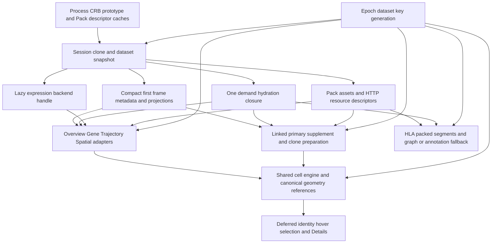

# Viewer shared data architecture audit

Date: 2026-10-10. Audited baseline: `e82cc31726e206712b191f0fe784187a82369938`.
Branch: `卧槽/pr6_clean_perf`, existing checkout, initially clean. This is a
current-production static audit before PR7 Builder, not an audit or integration
of the PR7 branch. Builder has not started.

Implementation commit: `4e6b0600` (image-cache ownership fix, two dead definitions,
and focused regression coverage). This report is committed separately.

The Viewer has a shared dataset foundation, canonical identity contract,
resource transport and browser cell engine. It does **not** have a single store
of all materialized page data. Linked retains the most independent cell-data
preparation; HLA has an independent graph domain for legitimate semantic reasons.
Unifying every page cache would require earlier materialization or changes to
page cohorts and contracts. That is not justified before Builder.

One actionable cache ownership omission and two dead definitions were found and
handled below. No remaining A/E item from this audit blocks Builder. Existing
native Brave acceptance remains incomplete under the previously recorded tool
restriction; static tracing and Node/R tests do not change that boundary.

## Production architecture

Production anchors below are repository-relative paths and function names; they
remain usable after the small dead-code deletions shift line numbers.

## Shared objects and mechanisms

| Object or mechanism | Production location | Consumers | Actual sharing | Repeated preparation | Cache overlap | Decision |
|---|---|---|---|---|---|---|
| CRB prototype and session snapshot | `utility_functions.R` `.cacheCrbPrototype`, `get_or_load_crb`, `.cloneCachedCrb`; `shiny_server.R` `viewer_dataset_snapshot` | All pages | One immutable prototype per normalized path/backend identity; one active session snapshot | Clone/backend attachment on activation, not every page | Prototype and shallow session clone use R copy-on-write; not evidence of two full deep copies | Retain session isolation |
| Thin compact first frame and hydration | `utility_functions.R` `.deferThinCrbHydration` | Cell pages and fallback consumers | Compact metadata/projections shared; one hydration closure serves metadata and projections | First demand reads barcode sidecar and validates/hydrates; repeated `getMetaData()` does not rehydrate | Compact and hydrated structures coexist, but columns can share storage | Preserve deferred access |
| Pack manifest and decoded assets | `core/viewer_pack.R` `viewerPackOpenCached`, `viewerPackReadAsset` | All eligible pages | Process descriptor validation cache; per-activation decoded asset environment | Asset checksum/decode on its first demand; small descriptor checks at callers | Different process/session/cache responsibilities | Retain |
| Canonical dataset identity | `shiny_server.R` `viewerDatasetIdentity`, `cv_saved_view_cells`; `utility_functions.R` context helpers | All pages | Stored cell and order fingerprints, one context authority | Legacy fingerprint fallback and caller-specific barcode validation remain | Barcode sidecar hydration and Pack cell-order asset can both exist | Preserve identity; no eager universal barcode store |
| Canonical projection geometry | `shiny_server.R` resource helpers; `www/cell_views.js` `cacheSharedProjection`, `reuseSharedProjection`, shared state helpers | Overview, Gene, Linked, eligible Trajectory | Browser coordinate arrays are assigned by reference; common GPU positions are reusable | Narrow R projection access still occurs; full canonical access can alias rather than copy | Source coordinates, decoded browser coordinates and GPU positions are different representations | Retain |
| Trajectory mapping and geometry | `trajectory/server.R` `trajectory_row_index_reactive`; `coordinated_views/bundle.R` `cv_build_trajectories`, `cv_reference_trajectory_geometry` | Trajectory and Linked | Standalone page uses Pack mapping/static State/excluded-index; Linked can reference canonical geometry | Linked fallback still matches cells and constructs full x/y before replacement | Same underlying trajectory is independently mapped by the two adapters | Real duplication; no reopened Linked optimization |
| Metadata categories and hover | `utility_functions.R` first-frame/subset/hover helpers; page preparation files | Cell pages | Same compact source; static category resources where eligible | Per-page cohort slicing, categorical conversion and summaries | Browser remapped codes and raw categorical codes can represent the same source with different semantics | Do not preload all metadata to share derivatives |
| Expression values | `utility_functions.R` `viewerExpressionRow`, `viewerExpressionValues`; `R/class-Cerebro.R` accessors | Gene, Spatial, trajectory outputs; Linked public accessor | Same active backend, common low-level accessors | Per requested row/cohort; Gene alone has a four-row LRU; Linked reads via its own adapter | R expression row and browser color vector overlap semantically, but serve computation vs rendering | Reader, precision and transport unchanged |
| Selection identity | `utility_functions.R` `viewerPersistentSelection`, `selectedCellMask`; `www/cell_views_state.js` `specialistSelectionReport` | Specialist cell pages | Shared stale gate and stable barcode comparison | Page cohort mapping and output masks remain local | Selection sets are UI state, not another dataset identity | Retain cohort-specific adapters |
| Linked selection and Details | `coordinated_views/server.R` `coordviews_selected_barcodes`; `bundle.R` canonical metadata helpers | Linked | Uses same canonical barcode source and context | Index-to-barcode conversion followed by full barcode validation/membership or match | Repeated scans, not a proven second complete metadata deep copy | Record; no new index/cache experiment |
| HLA segments and graph | `hla_tcr_motifs/data.R`, `core/hla_motifs.R` | HLA | Uses active CRB/Pack; annotation takes same metadata source | Fallback annotation and graph-specific derivation; packed assets bypass it | Raw and filtered graphs differ; first-frame segments deliberately avoid another `bindCache` wrapper | Preserve graph domain |
| Spatial coordinates and image frame | `spatial/obj_projection_data_to_plot.R`, `obj_projection_cells_to_show.R`, `func_projection_update_plot.R` | Spatial, Linked spatial adapter | Shared CRB/Pack sources and cell engine | Rotated/subset frames, full bounds and optional hulls are separate calculations | Image coordinates are not interchangeable with UMAP geometry | New ROI/content/coordinate contracts belong to Builder |

All Viewer paths in this table are under `inst/viewer/` unless prefixed `R/`.
BPCells storage layout is supplied by the existing backend/export contract;
page switches do not transpose the backend. Numeric subset validation, sorting
for storage reads and restoration of requested order remain per operation in
the shared accessors. These checks are not a second dataset initialization.

## Candidate decisions

Categories: A worthwhile now; B small duplication; C necessary isolation;
D Builder contract dependency; E removable dead code; F insufficient evidence
for a safe, valuable change in the present scope.

| Candidate | Extra cost at baseline | Complexity | Correctness risk | Builder effect | Decision |
|---|---|---|---|---|---|
| Generation-bound deferred image cache | Retains URI entries and pending keys after their generation becomes unreachable; no eviction | Two resets in existing invalidation function | Low; stale responses must still be rejected | Independent of future image contract | **A fixed** |
| Unused `hover_info_projections` reactive | Dormant reactive/cache registration; lazy body has no consumers | Delete 26 lines | Low; keep used formatter | None | **E removed**; no claimed million-row runtime saving |
| Unread `singleAsyncEpoch` | Unused declaration and increment | Delete two lines and stale test declaration | Low; real context/render checks unchanged | None | **E removed** |
| Linked full trajectory preparation before geometry reference | Per trajectory, canonical match plus N-length x/y vectors; approximately 16 MB of double elements at N=1M, excluding temporaries | Medium or larger to preserve all fallback contracts | Alignment/excluded-cell semantics | Future packed content may affect path selection | **F for further action**: duplicate is proven, safe net benefit of a new replacement is not; Linked work remains closed |
| Thin barcode hydration plus Pack cell-order asset | Separate N-element character-vector representations and validation when both demanded | Medium | Deferred loading/order/source trust | Strong identity contract relevance | **F**, do not force one eager barcode store; not proof of two copies of all string bytes |
| Metadata slicing and repeated selected-output scans | O(N) membership/validation in some demanded outputs; per-column trajectory slices | Medium | Selection/cohort and hidden-output semantics | Possible future descriptor changes | **F**, no new global metadata index/cache |
| Small descriptor checks and context comparisons | Small records; full canonical eligibility checks may scan index vectors | Low individually | Removing checks weakens validation | Low | **B/C**, retain; no measured bottleneck claim |
| Session clone, raw vs filtered HLA graph, GPU vs CPU arrays | Different owners or representations | High to combine | Cross-session mutation/rendering/graph semantics | None required now | **C**, retain |
| Spatial rotation, ROI and background harmonization | Conditional range/rotation work; new-contract behavior not present | Large if expanded | Coordinate interpretation and export compatibility | Direct dependency | **D**, Builder stage |

The largest remaining overlaps are trajectory reconstruction, barcode
representations, demanded metadata/mask work, page-local expression derivatives,
and categorical remapping. Some operate on a million elements. Static code does
not establish their simultaneous physical peak, retained-string duplication,
or a worthwhile whole-page speedup. R copy-on-write, JS aliases and encoded vs
decoded representations must not be counted as identical deep copies.

## Cache ownership and invalidation

| Cache | Key | Lifetime and invalidation | Generation | Stored object and consumers | Overlap assessment |
|---|---|---|---|---|---|
| CRB process prototypes | Normalized path; backend identity checked | R process; no explicit LRU in this path | No | Immutable prototype, all sessions/pages | Necessary source/session separation |
| Session snapshot and hydration | Reactive selected dataset/load context; hydration closure belongs to clone | Active snapshot replaced on load; objects released when references end | Snapshot context exact | Active R6, compact fields, hydrated metadata/projections | Shared fields can alias; not a guaranteed deep duplicate |
| Pack descriptor process cache | Path and CRB/manifest source signature | Revalidate on signature miss | No | Validated descriptor, all pages | Distinct from decoded-asset cache |
| Pack decoded assets | Asset path inside pack cache environment | Fresh environment per activation; retained by current consumers | Indirectly by snapshot ownership | Barcode/index/immune/other QS assets | Barcode content can overlap hydration |
| R HTTP descriptors | Pack path + projection asset; method/name; spatial geometry path; metadata code path/requested levels | Session resource registry; paths removed on session end | No, immutable resources | Small validated URL/checksum descriptors, cell pages | Not a coordinate-array cache |
| Gene expression rows | Pack fingerprint or selected-dataset fallback + gene; only full canonical rows eligible | Session LRU of four entries | Not generation-bound | Full precision rows, Gene | May survive A-B-A safely under immutable source contract; not shared with Linked |
| Browser expression colors | Transport color key, including dataset/expression identity | Four-entry LRU | Content keyed, not cleared solely by generation | Dense render color vectors, specialist engine | Different role from R rows |
| Linked R state | Reactive source/context plus primary counter, modality request, clone task identity | Replaced/reset on new visible primary; worker results checked against current source | Yes at publication/application | Primary/supplement/color/assets/clone details | Worker owns separate decoded assets by process necessity |
| Trajectory reactives and output cache | Dataset/method/name; metric output keys also identify the metric | Session/reactive invalidation and session `bindCache` | Freshness separate from memoized content | Row map, requested slices, metric output | Mapping independent of Linked; requested column slices remain local |
| HLA `hla_bindCache` | Dataset selection, chain, filter, scope, node metadata; final graph adds thresholds | Session `bindCache`; data gate outside cached body | Context guards UI separately | Annotation/segments/graphs, HLA | Raw graph reusable across threshold changes; filtered graph is different result |
| Spatial derived/image caches | Reactive sample/filter/rotation; Moran key includes context token; image path + size/mtime | Reactive/session and local image closure | Moran exact context; images immutable file version | Geometry derivatives, score, data URI | Images/ranges not interchangeable with projection geometry |
| Browser static resource maps | URL/checksum; metadata remap adds code-map suffix | Cleared by dataset invalidation; HTTP cache may still reuse bytes | Cleared, application gated | Decoded geometry/subset/raw categories/remapped codes | Raw unsigned vs remapped signed category arrays are not identical representations |
| Browser shared projection state | Cell fingerprint/count/order fingerprint + projection name | One shared base replaced on identity mismatch | Hints/messages require exact context | Coordinate aliases, units, GPU positions | True cross-page sharing; not an all-dataset history cache |
| Specialist views and pending aux | Exact context + view ID; wire/render token for aux | Reset on dataset invalidation; aux closures sent/discarded on demand | Yes | Page frame/UI state and pending server builders | Page settings and subset differ; preserve |
| Deferred Linked images | Exact context + fingerprint + asset key | **Now cleared on dataset invalidation**; same-generation reuse preserved | Yes | Image URI and pending-key set | Previously unreachable old generations were retained |

Immutable content keys and live generation keys serve different purposes.
An A-B-A switch invalidates live selections and requests even when content
caches can reuse A. These caches assume configured source files do not change
silently in place during a session; hot replacement is not certified here.
Session caches can retain multiple parameter results and process prototypes
can retain multiple datasets. This audit is not a whole-application heap bound.

## Identity and demand boundaries

The cell-page model is local displayed cell -> canonical integer mapping ->
stable barcode -> demanded metadata. R indices are one-based; browser canonical
indices are zero-based and translated through the existing helpers. Subsets and
reorders use explicit mappings. Numeric-looking barcodes stay strings; they are
not guessed to be temporary row numbers.

Specialist selection before deferred identity remains local and reports pending;
stable IDs are published when available. Gene summary/table use canonical
barcodes sliced by the displayed canonical indices. Linked can send canonical
indices directly and resolve them server-side. Trajectory resolves its subset
through the Pack row index or validated fallback. Spatial resolves sample order
before mapping selected cells. The coordinate fallback in `selectedCellMask`
still supports legacy callers without stable IDs and is not dead code.

HLA nodes represent receptors/motifs/alleles rather than one plotted cell each.
Its own node selection and saved-view state are appropriate; metadata annotation
still joins through canonical barcodes. A generic cell-selection replacement
would change its meaning.

| Demand stage | Data |
|---|---|
| Dataset activation | CRB/schema/backend attachment, compact fields, Pack descriptor, stored identity |
| First cell frame | Eligible geometry/resource descriptor, requested color/State/expression, minimal group levels |
| Hover/identity request | Stable barcode slice and requested compact/full hover columns through deferred aux |
| Selection | Canonical selected identities, summary variable/cohort mask, table metadata |
| Secondary panel or modality | Linked Details/clone details/images; trajectory metrics/table; HLA graph/annotation as required |

`getMetaData()` can trigger first thin hydration, but repeated calls share the
hydrated object. Subsequent slicing, barcode normalization, `%in%`, `match` and
factor preparation can still allocate or scan anew. In particular,
`trajectory_cells_reactive` is a function despite its name: consumers can build
different requested-column slices independently. This is API sharing rather
than one universally cached derived table.

## Lifecycle responsibilities

- **Epoch** separates server sessions/connections; **generation** distinguishes
  loads, including A-B-A; **dataset key** identifies the requested dataset.
  `dataset-context.js` is authoritative, with the same contract in R.
- **Selection nonce** prevents an older dataset-selector response reopening the
  gate. **Page request nonce** distinguishes a remount/re-request in the same
  dataset. Neither replaces generation.
- **Render key** identifies requested page content; **render token** orders
  frames within one context. **Wire token** attaches deferred aux to its frame.
  Context alone cannot reject an older gene response within the same dataset.
- **Painted key** acknowledges the matching actually painted frame and manages
  progress. It is not the data-availability or transport-receipt gate.
- **Visibility** prevents hidden-page work; it does not prove data freshness.
  Spatial's local context/request-seen fields choose raw vs debounced work on
  switch/remount. Linked primary/progressive/clone tokens order its stages.
  Image tokens protect rapid background changes inside one generation.
- Specialist lifecycle's local `generation` is a timing/operation counter,
  not a second dataset authority. The removed `singleAsyncEpoch` was unread;
  it provided no actual stale-result protection.

The previous same-session resumable reconnect limitation remains. Multiple
layers here have distinct scope; deleting them in favor of only generation
would regress same-dataset operation ordering and UI readiness.

## Static cross-page traces

Mouse trace assumes the established 1M Thin CRB/Viewer Pack fixture, full default
projection and normal demand gates. It is not a new measured browser sequence.

| Step | Already available and reused | New preparation and repeat work | Cache and revisit explanation |
|---|---|---|---|
| Overview | Dataset snapshot, compact metadata/projections, stored fingerprints, Pack descriptor | Requested group/levels and resource validation; full canonical source access avoids subset copy | Browser geometry/category resources and shared base populated; no mandatory full barcode hydration |
| Gene | Same CRB/backend attachment and compact source; eligible geometry reuses browser arrays | First demanded expression/backend initialization, row read and render preparation; aux identity/hover later | Gene four-row LRU plus specialist frame/color state; shape/subset validation still runs as needed |
| Linked | Same snapshot, canonical primary geometry and context | Primary; requested supplement; Mouse trajectory causes full supplement fallback, canonical metadata validation/mapping and trajectory coordinate construction before reference replacement; clone worker separate | Primary/supplement counters and retained browser workspace; tiny primary wire size does not describe R preparation or static bytes |
| Trajectory | Same Pack, canonical geometry, compact source; metadata may already be hydrated by Linked | Its own row-index validation, State/excluded-index frame, optional per-column slices; identity/table/aux demanded later | Pack index cache and specialist state; still independent of Linked's earlier match |
| Gene revisit | Same active snapshot, geometry, row LRU, mounted selector/frame if still valid | Changed controls/uncached gene/cohort still require work; deferred output may newly demand metadata | Speed comes from retained/memoized frame and row data, not proof of zero preparation on first cross-page entry |

For **Ren Gene -> HLA**, the CRB snapshot and backend configuration are shared.
HLA does not need to read a Gene expression row to build its receptor graph.
When the active Pack has matching HLA segment/first-frame assets, they are used
directly. Otherwise HLA obtains repertoire plus metadata, annotates missing
columns through the barcode join, then parses and derives graph data. Annotation
joins are consolidated across eligible sample tables; it is not one full match
per sample. If Gene already demanded identity, HLA reuses hydrated metadata but
still creates repertoire-specific annotations. Actual packed capability depends
on the active Ren manifest; no new Ren load/benchmark was run to assert it.

For **Spatial**, full unrotated eligible ImageDimPlot resolves geometry/category
resources before materializing displayed metadata/coordinates. Filtered,
rotated, numeric feature and outline modes retain local slices, bounds and hull
preparation. Full bounds keep axes stable when the shown subset changes. These
are partly repeated coordinate operations but often different inputs/outputs.
No Spatial ROI/background or new Builder contract was imported.

## Minimal changes and verification

The A path is `requestDeferredAsset` -> `coordviews_asset` handler -> `assetCache`.
Its key includes the exact dataset context. Before this change,
`invalidateDatasetViewState` cleared static resources and live image state but
not `assetCache` or `pendingAssets`. Completed images and abandoned pending keys
therefore survived under unusable old-generation keys. The fix assigns an empty
URI cache and clears the pending set at that existing invalidation boundary.
Same-generation reuse and the existing freshness check remain unchanged.

`tests/testthat/fixtures/deferred-asset-lifetime.js` executes extracted production
request/invalidation/response functions with the actual `dataset-context.js`
gate and stubs only UI effects. Before the production fix it failed at A -> B
with `retired image URI remains owned`, actual 1 vs expected 0. After the fix it
passes A -> B -> A, pending request deduplication, same-generation loaded-image
reuse, retired ownership release, and late A/B response rejection without
clearing the new A request. This demonstrates ownership semantics, not measured
browser RSS or a rendering speedup.

Repository-wide references to `hover_info_projections` were only its definition
and comment. Its lazy body was not a current runtime million-row workload.
`buildHoverInfoForProjections` remains used by Gene pseudotime and was preserved.
`singleAsyncEpoch` only had a declaration and increment, plus a test declaration;
all were removed. Live context/render/wire/image gates were preserved.

Validation environment: Windows checkout and Node 22.23.1 for the direct fixture
and JS syntax check; **R runs in WSL**, using this checkout via `pkgload::load_all`.
The following five testthat suites passed with `stop_on_failure=TRUE`:

- `deferred-asset-lifetime`
- `static-resource-lifetime`
- `viewer-dataset-context`
- `cell-view-wire`
- `viewer-hover-metadata`

`shiny_server.R` parses, `node --check inst/viewer/www/cell_views.js` passes, and
`git diff --check` passes. No formal benchmark, profiling, new browser interaction
or Spatial page regression was run. No Spatial production file changed; the
new fixture targets the shared deferred-image boundary. Existing 198 PR7
integration assertions and offline Mouse/Demo evidence are historical results,
not relabeled as new executions here.

No new payload, first materialization, expression read or retained cache was
added. Cache ownership is reduced at invalidation; no quantitative heap claim.
Precision, RGB, geometry, wire, RAF, BPCells and ready/paint gates are unchanged.
No new functional failure appeared in completed tests. Native UI validation
retains the explicit limitation in `../pr7-integration/RESULTS.md`.

## Builder handoff decision

Viewer sharing is mature at the source, identity, immutable-resource and browser
engine levels, with intentionally local derived data. The present changes
remove the one clear cache-lifetime omission and two unused definitions.
No further Viewer modification is recommended before Builder.

Builder should own future output/content/coordinate contracts, especially
Spatial ROI, background choice and coordinate rotation/export alignment.
It should document canonical order and asset capability/fingerprint boundaries
so consumers can choose existing fast paths without building full fallback
objects first. That is a contract discussion for Builder, not authorization to
restart Linked, Gene, Trajectory, HLA or Spatial optimization now.

No push, branch/worktree creation, PR7 modification or Builder implementation.
